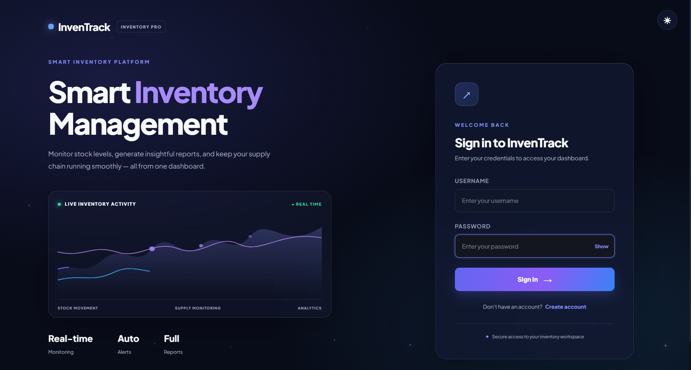
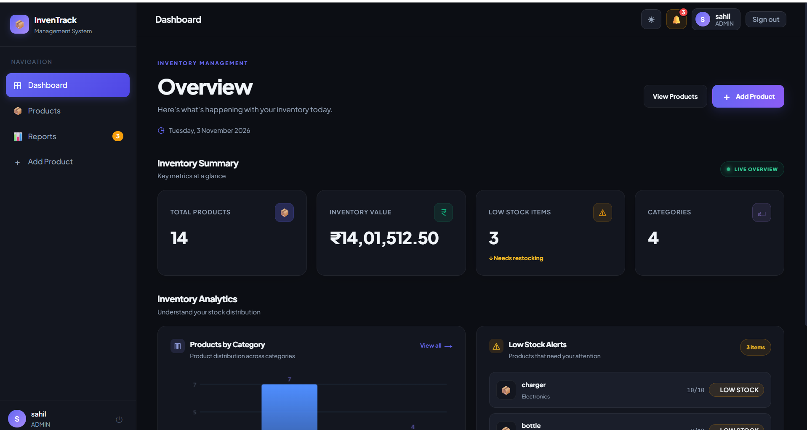

# Inventory Monitoring & Reporting System

A full-stack inventory management application developed using **Java 21, Spring Boot, React.js, and Oracle Database 26ai Free**. The application provides product management, stock monitoring, category and supplier management, user authentication, and inventory reporting through a responsive web interface.

---

## Table of Contents

- [Project Overview](#project-overview)
- [Features](#features)
- [Tech Stack](#tech-stack)
- [Project Structure](#project-structure)
- [Architecture Overview](#architecture-overview)
- [Database Configuration](#database-configuration)
- [Getting Started](#getting-started)
- [API Overview](#api-overview)
- [Security](#security)
- [Screenshots](#screenshots)
- [Future Enhancements](#future-enhancements)
- [Developer](#developer)

---

## Project Overview

The Inventory Monitoring & Reporting System is designed to simplify inventory operations and provide centralized management of products and stock information.

The application follows a full-stack architecture:

- **Frontend:** React.js provides an interactive user interface.
- **Backend:** Spring Boot handles business logic and REST API requests.
- **Database:** Oracle Database stores product, category, supplier, and user information.
- **Authentication:** JWT-based authentication protects application access.

---

## Features

### Backend Features

- **JWT Authentication:** Token-based user authentication and session validation.
- **Role-Based Access:** Supports role-based application access for different users.
- **Product Management:** Create, view, update, and delete product records.
- **Category Management:** Organize products into categories.
- **Supplier Management:** Associate products with suppliers.
- **Stock Management:** Monitor product quantities and inventory levels.
- **RESTful APIs:** Handle frontend-backend communication through REST endpoints.
- **Database Integration:** Manage application data using Spring Data JPA, Hibernate, and Oracle Database.
- **Input Validation:** Validate product information before processing requests.

### Frontend Features

- **Login and Registration:** User authentication interface.
- **Dashboard:** Display inventory information and summary statistics.
- **Product Management:** View, search, add, and update product information.
- **Product Categories:** Select categories while managing products.
- **Supplier Selection:** Associate products with available suppliers.
- **Stock Monitoring:** Track product quantities and stock levels.
- **Reports:** Display inventory-related information.
- **Protected Routes:** Restrict access to application pages based on authentication.
- **Responsive Interface:** User-friendly React-based application interface.

---

## Tech Stack

### Backend

| Technology        | Purpose              |
| ----------------- | -------------------- |
| Java 21           | Programming Language |
| Spring Boot 3.2.5 | Backend Framework    |
| Spring Security   | Application Security |
| Spring Data JPA   | Database Operations  |
| Hibernate         | ORM Framework        |
| JWT               | Authentication       |
| Maven             | Build Management     |
| REST APIs         | Backend Services     |

### Frontend

| Technology   | Purpose              |
| ------------ | -------------------- |
| React.js     | Frontend Framework   |
| JavaScript   | Programming Language |
| HTML5        | Page Structure       |
| CSS3         | Styling              |
| Axios        | HTTP Requests        |
| React Router | Navigation           |
| Context API  | State Management     |

### Database

| Technology                | Purpose               |
| ------------------------- | --------------------- |
| Oracle Database 26ai Free | Relational Database   |
| Oracle SQL                | Database Queries      |
| SQL\*Plus                 | Database Management   |
| JDBC Driver               | Database Connectivity |

### Development Tools

- Visual Studio Code
- Eclipse IDE
- Postman
- Git
- GitHub
- Apache Maven
- SQL\*Plus

---

## Project Structure

```text
Inventory-Monitoring-and-Reporting-System/
│
├── backend/
│   ├── src/
│   │   ├── main/
│   │   │   ├── java/com/inventory/
│   │   │   │   ├── controller/
│   │   │   │   ├── dao/
│   │   │   │   ├── security/
│   │   │   │   ├── service/
│   │   │   │   └── database_system/
│   │   │   │       ├── entity/
│   │   │   │       └── repository/
│   │   │   │
│   │   │   └── resources/
│   │   │       └── application.properties
│   │   │
│   │   └── test/
│   └── pom.xml
│
├── frontend/
│   ├── public/
│   ├── src/
│   │   ├── components/
│   │   ├── context/
│   │   ├── hooks/
│   │   ├── pages/
│   │   ├── services/
│   │   ├── utilities/
│   │   └── styles/
│   │
│   └── package.json
│
└── README.md
```

---

## Architecture Overview

```text
             USER
               |
               v
       React.js Frontend
               |
               | HTTP Requests
               | JWT Authorization
               v
       Spring Boot Backend
               |
        -----------------
        |       |       |
        v       v       v
    Controller Service Security
        |
        v
      DAO / Repository
        |
        v
     Spring Data JPA
        |
        v
    Oracle Database
        |
   -------------------
   |       |         |
Products Categories Suppliers
```

---

## Database Configuration

This project uses **Oracle Database 26ai Free** with the `FREEPDB1` pluggable database service.

### Database Details

| Property      | Value           |
| ------------- | --------------- |
| Database      | Oracle Database |
| Service Name  | FREEPDB1        |
| Database User | inventory_user  |
| Database      | Oracle SQL      |
| ORM           | Hibernate / JPA |

### Main Database Tables

**1. Products**

- Product ID
- Product Name
- SKU
- Description
- Quantity
- Unit Price
- Reorder Level
- Category ID
- Supplier ID

**2. Categories**

- Category ID
- Category Name

**3. Suppliers**

- Supplier ID
- Supplier Name

**4. Users**

Stores application user information required for authentication and access management.

---

## Getting Started

### Prerequisites

Install the following before running the application:

- Java JDK 21
- Apache Maven 3.8+
- Node.js and npm
- Oracle Database 26ai Free
- Git
- VS Code or Eclipse

### 1. Clone the Repository

```bash
git clone https://github.com/sahilsangle24/Inventory-Monitoring-and-Reporting-System.git
```

Navigate to the project:

```bash
cd Inventory-Monitoring-and-Reporting-System
```

### 2. Configure Oracle Database

1. Start Oracle Database.
2. Connect to the `FREEPDB1` service.
3. Create or configure the `inventory_user` database account.
4. Ensure the required database privileges are available.

Example connection:

```text
jdbc:oracle:thin:@localhost:1521/FREEPDB1
```

### 3. Configure Backend

Open:

```text
backend/src/main/resources/application.properties
```

Configure the database connection:

```properties
spring.datasource.url=${DB_URL:jdbc:oracle:thin:@localhost:1521/FREEPDB1}
spring.datasource.username=${DB_USERNAME:inventory_user}
spring.datasource.password=${DB_PASSWORD}
spring.datasource.driver-class-name=oracle.jdbc.OracleDriver

spring.jpa.hibernate.ddl-auto=update
spring.jpa.show-sql=true
```

Set your database password through an environment variable instead of committing it to GitHub.

**PowerShell:**

```powershell
$env:DB_PASSWORD="YOUR_ORACLE_PASSWORD"
```

### 4. Run the Spring Boot Backend

Open a terminal:

```powershell
cd backend
```

Run the application:

```bash
mvn spring-boot:run
```

The backend runs at:

```text
http://localhost:8080
```

### 5. Run the React Frontend

Open another terminal:

```powershell
cd frontend
```

Install the dependencies:

```bash
npm install
```

Start the React application:

```bash
npm start
```

The frontend runs at:

```text
http://localhost:3000
```

---

## API Overview

The backend provides REST APIs for authentication and inventory operations.

### Authentication APIs

| Method | Endpoint         | Description                     |
| ------ | ---------------- | ------------------------------- |
| POST   | `/auth/register` | Register a new user             |
| POST   | `/auth/login`    | Authenticate user               |
| GET    | `/auth/me`       | Validate current authentication |

### Product APIs

| Method | Endpoint            | Description       |
| ------ | ------------------- | ----------------- |
| GET    | `/api/products`     | Retrieve products |
| POST   | `/api/product`      | Add a product     |
| PUT    | `/api/product/{id}` | Update a product  |
| DELETE | `/api/product/{id}` | Delete a product  |

**Note:** Additional endpoints for stock operations and reporting are implemented according to the backend controllers.

---

## Security

- JWT-based authentication.
- Password-based user authentication.
- Protected frontend routes.
- Token validation through backend security filters.
- Role-based access control.
- Database credentials maintained outside publicly committed source code.

---

## Screenshots

Add screenshots of your actual application here to help recruiters understand the project.

Suggested screenshots:

## Screenshots

### Login Page



### Dashboard



### Product Management


### Add Product


Example:

```markdown


```

---

## Future Enhancements

- Low-stock notification system.
- Advanced inventory analytics.
- Export reports to PDF and Excel.
- Dynamic category and supplier loading.
- Improved dashboard visualizations.
- Enhanced backend authorization.

---

## Learning Outcomes

Through this project, I gained practical experience in:

- Full-stack application development using Java and React.js.
- Developing RESTful APIs using Spring Boot.
- Implementing JWT authentication.
- Database integration using Oracle SQL and Hibernate.
- Performing CRUD operations using Spring Data JPA.
- Managing frontend and backend communication.
- Using Git and GitHub for version control.

---

## Developer

**Sahil Sangale**

Java Developer | Java Full Stack Developer

- GitHub: [sahilsangle24](https://github.com/sahilsangle24)
- Project Repository: [Inventory Monitoring & Reporting System](https://github.com/sahilsangle24/Inventory-Monitoring-and-Reporting-System)

---

⭐ If you find this project useful, consider giving the repository a star!
